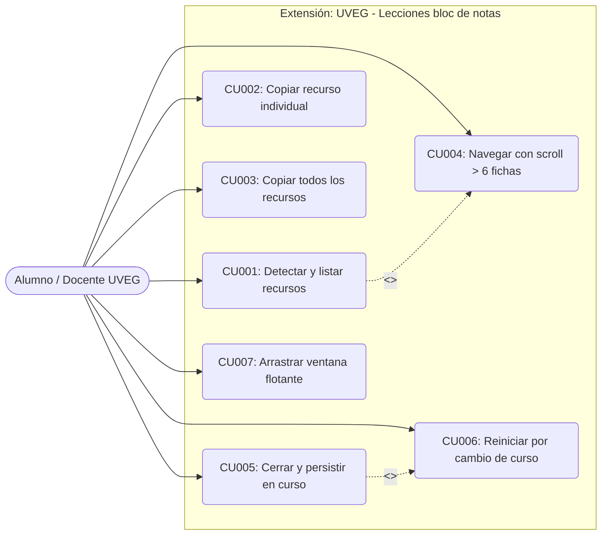

# Catálogo de Casos de Uso

**Proyecto:** UVEG - Lecciones bloc de notas  
**Versión:** 1.4.3  
**Fecha:** 2026-10-24  

---

## 1. Definición de Actores

| Actor | Tipo | Descripción |
| :--- | :---: | :--- |
| **Alumno UVEG** | Humano / Principal | Estudiante matriculado en el Campus Virtual UVEG que consulta lecciones y retos interactivos. |
| **Docente / Asesor UVEG** | Humano / Secundario | Asesor virtual o tutor que revisa y recopila enlaces de actividades del curso. |
| **Campus Virtual Moodle** | Sistema Externo | Plataforma LMS (`avalicmod19d.uveg.edu.mx`) donde residen las aulas y las actividades incrustadas. |
| **Genially CDN** | Sistema Externo | Servidor de contenidos interactivos incrustados (`view.genial.ly`, `view.genially.com`). |

---

## 2. Catálogo General de Casos de Uso

| Identificador | Nombre del Caso de Uso | Descripción Resumida | Actores Participantes |
| :---: | :--- | :--- | :--- |
| **CU001** | Detectar y listar recursos del curso | Identifica automáticamente todos los recursos incrustados de la vista de curso y los despliega ordenados en la tarjeta flotante. | Alumno / Docente, Campus Moodle |
| **CU002** | Copiar recurso individual | Permite copiar al portapapeles el título y enlace de una ficha específica con un solo clic. | Alumno / Docente |
| **CU003** | Copiar todos los recursos del curso | Concatena y copia al portapapeles la lista completa de recursos del curso en formato estandarizado. | Alumno / Docente |
| **CU004** | Navegar lista con scroll (> 6 fichas) | Permite desplazarse verticalmente por la lista cuando existen más de 6 recursos, manteniendo la ventana compacta. | Alumno / Docente |
| **CU005** | Cerrar widget y persistir estado en curso | Cierra la ventana flotante y registra en `sessionStorage` que ese curso ya fue cerrado, manteniéndolo cerrado al navegar en páginas hijas. | Alumno / Docente |
| **CU006** | Reiniciar widget por cambio de curso | Al detectar un nuevo ID de curso (`id=` diferente), reinicia el estado y reabre automáticamente la ventana para ese curso. | Alumno / Docente, Campus Moodle |
| **CU007** | Arrastrar y posicionar ventana flotante | Permite desplazar la ventana a cualquier punto de la pantalla para evitar tapar contenidos de estudio. | Alumno / Docente |

---

## 3. Matriz de Trazabilidad: Requerimientos vs Casos de Uso

| Caso de Uso | Requerimientos Funcionales Cubiertos | Requerimientos No Funcionales |
| :---: | :---: | :---: |
| **CU001** | RF-01, RF-02, RF-03 | RNF-P01, RNF-P02, RNF-P03, RNF-P04 |
| **CU002** | RF-04 | RNF-O01, RNF-P05 |
| **CU003** | RF-05 | RNF-O01, RNF-P05 |
| **CU004** | RF-06 | RNF-P05 |
| **CU005** | RF-07 | RNF-P02, RNF-E01 |
| **CU006** | RF-07 | RNF-P02, RNF-E01 |
| **CU007** | RF-08 | RNF-P05 |

---

## 4. Diagrama de Casos de Uso (Mermaid)

